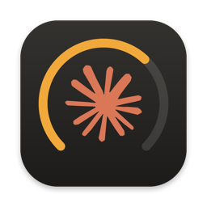
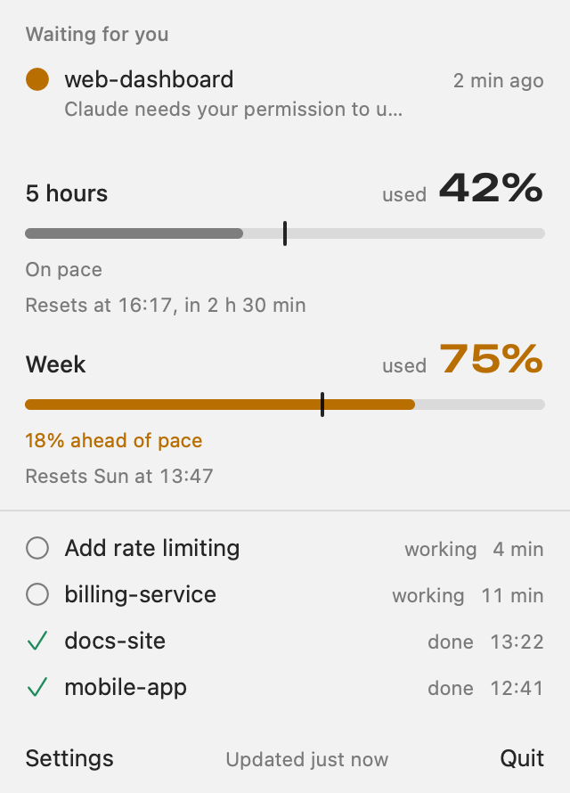
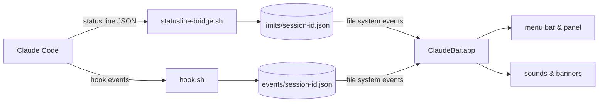

<p align="center">
  
</p>

<h1 align="center">ClaudeBar</h1>

<p align="center">
  Your Claude Code limits and sessions, one glance away in the macOS menu bar.
</p>

<p align="center">
  
  
  
  
</p>

<p align="center">
  <picture>
    <source media="(prefers-color-scheme: dark)" srcset="assets/panel-dark.png">
    
  </picture>
</p>

You run several Claude Code sessions, switch to another window, and miss the one that has been waiting for your permission for ten minutes. Or you find out you have burned through the 5-hour limit only when Claude stops answering. ClaudeBar sits in the menu bar and keeps both in view: how much of each limit you have used and how fast, and which session needs you right now.

## Features

- **Limits at a glance.** The 5-hour and weekly windows, with the share used, the reset time and the time left.
- **Pace, not just a percentage.** A tick on each bar marks how much of the window's time has passed. If usage runs 10 points or more ahead of it, the bar turns amber: at this rate you will hit the limit before it resets. At 90% it turns red.
- **A menu bar that tells you what matters.** <picture><source media="(prefers-color-scheme: dark)" srcset="assets/label-dark.png"></picture> shows the busier window's percentage, plus an amber badge with the number of sessions waiting for you.
- **Every session in one place.** Working, waiting or done, under the names Claude Code gives them. Waiting sessions come first, with the question they are asking.
- **Alerts that know when to keep quiet.** A sound and a banner when a session finishes or needs your permission, with different sounds for the two. No banner while you are already in that session's app (Terminal, iTerm2, VS Code, a JetBrains IDE…); the sound still plays.
- **Limit warning.** One alert per window when usage passes 80% (adjustable from 50% to 100%).
- **Featherweight.** No polling. ClaudeBar wakes on file changes and at the exact moments something changes (a reset, a session going stale), and sleeps otherwise: about 15 MB of memory and practically no CPU.
- **Private by design.** Sandboxed, with no network access. It never reads prompts, transcripts or credentials. **Private mode** goes further: no text from Claude and no session names in banners, the panel or stored files.
- **Ready for work accounts.** On plans that report no limits it shows the day's cost instead, it warns when company policy blocks it, and it keeps two Claude Code profiles apart. See [Using ClaudeBar at work](#using-claudebar-at-work).
- **Starts itself.** The first Claude Code session after a restart launches it in the background.
- **English or Ukrainian.** Follows the system language; switch in Settings.
- **One command to install, one to remove.** Your status line keeps working exactly as before, and if you have none, ClaudeBar adds none.

## Requirements

- macOS 14 or later.
- Swift 6: Xcode 16 or later, or just the Command Line Tools (`xcode-select --install`).
- `jq`, which ships with recent macOS as `/usr/bin/jq` (otherwise `brew install jq`).
- Claude Code. Sessions and alerts work with any account and setup, through hooks. Limits arrive only through Claude Code's status line, so they need one (any status line will do; ClaudeBar passes its data along) and a plan whose status line reports them: Claude Code documents this for Pro and Max. On other plans ClaudeBar shows the day's estimated cost instead.

## Install

```sh
git clone https://github.com/nazaryuzhyn/claude-bar.git
cd claude-bar
scripts/install.sh
```

The script:

1. runs the tests of the scripts Claude Code will execute and of the installer itself, and stops if any fails;
2. builds `ClaudeBar.app`, signs it locally and installs it to `~/Applications`;
3. copies the hook and the status line scripts to `~/Library/Application Support/ClaudeBar/bin`;
4. adds ClaudeBar's hooks to `~/.claude/settings.json` (backing the file up first) and connects the status line:
   - you have one: ClaudeBar's script passes the data on to yours, so it shows exactly what it showed before;
   - you have none: none is added. You get sessions and alerts, and the panel says limits need a status line. To see limits, click **Limits → Turn on** in Settings: with your next action in Claude Code, ClaudeBar adds a minimal status line (model and folder). Or make your own with `/statusline` in Claude Code and run `scripts/install.sh` again;
   - your status line already calls `statusline-bridge.sh`: it is left alone;
5. launches ClaudeBar.

Then allow notifications when macOS asks (or later in **System Settings → Notifications → ClaudeBar**). Limits appear after the next reply in any session.

> [!TIP]
> Claude Code can play its own notification sound. To hear one sound instead of two, set `"preferredNotifChannel": "notifications_disabled"` in `~/.claude/settings.json`.

There are no prebuilt binaries: the app is built and signed on your Mac, so Gatekeeper has nothing to quarantine.

**Update:** `git pull && scripts/install.sh`. Running it again is safe; nothing is added twice.

**Uninstall:** `scripts/uninstall.sh`. It removes ClaudeBar's hooks from every profile it was connected to, restores your previous status lines, deletes the app and its data. macOS keeps the sandbox folder `~/Library/Containers/local.claudebar.menubar` (delete it in Finder) and, if you enabled it, the login item.

## How it works



Claude Code already knows everything ClaudeBar shows. Two small shell scripts pass it on:

| Script | Runs | Writes | Contents |
| --- | --- | --- | --- |
| `statusline-bridge.sh` | in the background on each status line refresh | `limits/<session_id>.json` | rate limits, the session's name and cost |
| `hook.sh` | as an async hook on session start, prompt, tool use, stop, permission request and session end | `events/<session_id>.json` | state (working, waiting, done), project folder, app, up to 150 characters of the last message |

Both folders live in `~/Library/Application Support/ClaudeBar/`. Every session writes only its own file, so concurrent sessions never collide. The app watches the folders with a file system event source, reads them only when something changes, and takes each limit from the newest window across all sessions.

## Settings

Click the menu bar item, then **Settings**:

- **Sound** and **Banners**, separately;
- **Warn when N% is used**, the threshold for the limit warning;
- **Launch at login**;
- **Private mode**: no text from Claude and no session names, anywhere ClaudeBar shows or keeps them;
- **Limits → Turn on**, when you have no status line: adds ClaudeBar's minimal one, the only way limits reach ClaudeBar;
- **Language**: English or Українська;
- **Test sound and banner**;
- when the last Claude Code event and the last limits arrived, for a quick health check.

## Privacy and security

- **Sandboxed app, no network.** It can read and write only `limits/` and `events/`, not even the scripts in `bin/`.
- **Minimal data.** No prompts, tool arguments, transcripts or credentials are stored. A message is cut to 150 characters. Files older than 48 hours are deleted.
- **Hooks that stay out of the way.** They run asynchronously, print nothing, always exit 0, and the session id must match `[A-Za-z0-9_-]+` before it becomes a file name.
- **Scripts that do not trust their input.** Data reaches `jq` only on stdin or as jq arguments, never through `eval` or shell arithmetic. Temporary files live where the sandboxed app cannot reach, and symlinks in the data folders are never followed.
- **Careful installer.** It runs the script and installer tests first, backs up `settings.json` before changing it, keeps its permissions and any symlink to it, and leaves a broken `settings.json` untouched.

> [!NOTE]
> A banner can include up to 150 characters of Claude's reply, and macOS may show it on the lock screen. To prevent that: **System Settings → Notifications → Show previews → When Unlocked**, or turn on private mode.

## Using ClaudeBar at work

Nothing ClaudeBar records leaves your Mac, so it adds no new place your company's code or conversations go. What changes at work is what Claude Code reports, what your company allows, and who can see your screen.

**What you get on each kind of account**

| Account | Limits | Sessions and alerts |
| --- | --- | --- |
| Pro, Max | 5-hour and weekly bars | ✓ |
| Team, Enterprise | bars if Claude Code reports the limits; otherwise today's cost, after the first reply | ✓ |
| API key, Amazon Bedrock, Google Vertex AI | today's cost at API prices, after the first reply | ✓ |

The cost is Claude Code's own estimate at API list prices, summed over today's sessions. On a usage-billed account that is close to what you pay; on a seat plan it is only a measure of how much you used.

**Company policy.** Organizations can restrict Claude Code with managed settings. Three of them affect ClaudeBar, and `scripts/install.sh` warns about each one it finds in `/Library/Application Support/ClaudeCode/` or in an MDM profile:

- `allowManagedHooksOnly`: no sessions or alerts, because ClaudeBar's hooks do not run. Limits still work. The panel then says that no session events arrive.
- `disableAllHooks`: nothing works, because the status line is turned off as well.
- a managed `statusLine`: no limits, because it replaces the one that feeds ClaudeBar.

Settings pushed from the Claude admin console are not on disk, so the installer cannot see them. If in doubt, ask whoever manages Claude Code for your team before installing anything that adds hooks.

**Keep conversations off the screen.**

- Turn on **Private mode** in Settings. Banners then name only the project folder and the event, the panel shows folder names, and the scripts stop storing Claude's messages and session names. Texts stored before, and banners already in Notification Center, are removed at once.
- Before you share your screen, check **System Settings → Notifications → Allow notifications when mirroring or sharing the display**.
- Set **Show previews** to **When Unlocked**.

**Two profiles on one Mac.** If you run a personal and a work Claude Code with `CLAUDE_CONFIG_DIR`, connect each profile:

```sh
scripts/install.sh                                         # the default ~/.claude
CLAUDE_CONFIG_DIR=~/.claude-work scripts/configure.sh install
```

Each profile keeps its own status line. Sessions from both appear in one list. Limits never mix: the panel shows each profile's limits under its name, the menu bar shows the most used one, and limit warnings name the profile and are counted per profile. `scripts/uninstall.sh` disconnects every profile.

**What stays on disk.** `~/Library/Application Support/ClaudeBar/` holds, per session: the state, the project folder, the app it runs in, the session name and up to 150 characters of the last message (both left out in private mode), the limits and the cost. Files are readable only by you and are deleted after 48 hours. To keep them out of Time Machine as well: `tmutil addexclusion ~/Library/Application\ Support/ClaudeBar`.

## Troubleshooting

| Symptom | What to check |
| --- | --- |
| No limits | They appear after the next reply, and only with a status line. If the panel says it is not set up, click **Limits → Turn on** in Settings. Otherwise check that `statusLine` in `~/.claude/settings.json` points to ClaudeBar's script or that yours calls `statusline-bridge.sh`. |
| No sessions | Settings shows when the last Claude Code event arrived. If never, check the `hooks` in `~/.claude/settings.json`, then restart the Claude Code session. |
| "No session events arrive" | Limits come in but hook events do not: a company policy most likely allows only its own hooks. See [Using ClaudeBar at work](#using-claudebar-at-work). |
| Only today's cost, no limits | Your plan's status line reports no limits. See [Using ClaudeBar at work](#using-claudebar-at-work). |
| No banners | **System Settings → Notifications → ClaudeBar**. Banners are also skipped while the session's app is in front. |
| Two sounds | See the tip on `preferredNotifChannel` above. |
| Anything else | `log stream --level debug --predicate 'subsystem == "local.claudebar"'` shows every read, notification decision and wake-up. |

## Development

```sh
scripts/test.sh                       # Swift Testing suite
scripts/test.sh --filter TextsTests   # one suite, or "Suite/test" for one test
scripts/test-hooks.sh                 # hook and bridge, against a scratch folder
scripts/test-install.sh               # install/uninstall of the settings, against a scratch HOME
scripts/bundle.sh                     # rebuild and reinstall the app only
```

- Logic lives in the `ClaudeBarCore` library (parsing, aggregation, pace, transitions, wording) and is unit-tested with a fixed clock. The `ClaudeBar` target is the SwiftUI and AppKit layer.
- Builds go to `~/Library/Caches/ClaudeBar`: `codesign` rejects bundles built in an iCloud-synced `~/Desktop`.
- `~/Library/Caches/ClaudeBar/build/debug/ClaudeBar --snapshot <folder>` renders the panel and the menu bar label to PNG in light and dark mode. Point `CLAUDEBAR_DIR` at a folder of sample data and add `-language en` or `-language uk`. The screenshots above were made this way.

## Credits and license

ClaudeBar is released under the [MIT License](LICENSE).

The notification sound generator, the banner handling and the folder watcher are adapted from [Lunavect](https://github.com/lovach/Lunavect) (MIT). The Claude mark comes from [LobeHub Icons](https://github.com/lobehub/lobe-icons) (MIT). See [THIRD_PARTY_NOTICES](THIRD_PARTY_NOTICES).

ClaudeBar is an independent, unofficial project. It is not affiliated with, sponsored or endorsed by Anthropic. Claude and the Claude mark are trademarks of Anthropic, PBC.
