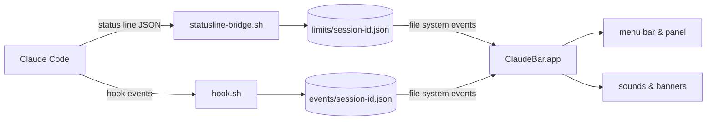

<p align="center">
  
</p>

<h1 align="center">ClaudeBar</h1>

<p align="center">
  Your Claude Code limits and sessions, one glance away in the macOS menu bar.
</p>

<p align="center">
  
  
  
  
</p>

<p align="center">
  <picture>
    <source media="(prefers-color-scheme: dark)" srcset="assets/panel-dark.png">
    
  </picture>
</p>

You run several Claude Code sessions, switch to another window, and miss the one that has been waiting for your permission for ten minutes. Or you find out you have burned through the 5-hour limit only when Claude stops answering. ClaudeBar sits in the menu bar and keeps both in view: how much of each limit you have used and how fast, and which session needs you right now.

## Features

- **Limits at a glance.** The 5-hour and weekly windows, with the share used, the reset time and the time left.
- **Pace, not just a percentage.** A tick on each bar marks how much of the window's time has passed. If usage runs 10 points or more ahead of it, the bar turns amber: at this rate you will hit the limit before it resets. At 90% it turns red.
- **A menu bar that tells you what matters.** <picture><source media="(prefers-color-scheme: dark)" srcset="assets/label-dark.png"></picture> shows the busier window's percentage, plus an amber badge with the number of sessions waiting for you.
- **Every session in one place.** Working, waiting or done, under the names Claude Code gives them. Waiting sessions come first, with the question they are asking.
- **Alerts that know when to keep quiet.** A sound and a banner when a session finishes or needs your permission, with different sounds for the two. No banner while you are already in that session's app (Terminal, iTerm2, VS Code, a JetBrains IDE…); the sound still plays.
- **Limit warning.** One alert per window when usage passes 80% (adjustable from 50% to 100%).
- **Featherweight.** No polling. ClaudeBar wakes on file changes and at the exact moments something changes (a reset, a session going stale), and sleeps otherwise: about 15 MB of memory and practically no CPU.
- **Private by design.** Sandboxed, with no network access. It never reads prompts, transcripts or credentials.
- **Starts itself.** The first Claude Code session after a restart launches it in the background.
- **English or Ukrainian.** Follows the system language; switch in Settings.
- **One command to install, one to remove.** Your existing status line keeps working.

## Requirements

- macOS 14 or later.
- Swift 6: Xcode 16 or later, or just the Command Line Tools (`xcode-select --install`).
- `jq`, which ships with recent macOS as `/usr/bin/jq` (otherwise `brew install jq`).
- Claude Code signed in with a Claude subscription (Pro or Max). Its status line receives rate limits only then. Without them, sessions and alerts still work and the limits section stays empty.

## Install

```sh
git clone https://github.com/nazaryuzhyn/claude-bar.git
cd claude-bar
scripts/install.sh
```

The script:

1. runs the tests of the scripts Claude Code will execute, and stops if any fails;
2. builds `ClaudeBar.app`, signs it locally and installs it to `~/Applications`;
3. copies the hook and the status line scripts to `~/Library/Application Support/ClaudeBar/bin`;
4. adds ClaudeBar's hooks to `~/.claude/settings.json` (backing the file up first) and connects the status line:
   - you have no status line: you get a minimal one, `Model · folder`;
   - you have one: ClaudeBar's script passes the data on to yours, so it shows exactly what it showed before;
   - your status line already calls `statusline-bridge.sh`: it is left alone;
5. launches ClaudeBar.

Then allow notifications when macOS asks (or later in **System Settings → Notifications → ClaudeBar**). Limits appear after the next reply in any session.

> [!TIP]
> Claude Code can play its own notification sound. To hear one sound instead of two, set `"preferredNotifChannel": "notifications_disabled"` in `~/.claude/settings.json`.

There are no prebuilt binaries: the app is built and signed on your Mac, so Gatekeeper has nothing to quarantine.

**Update:** `git pull && scripts/install.sh`. Running it again is safe; nothing is added twice.

**Uninstall:** `scripts/uninstall.sh`. It removes ClaudeBar's hooks, restores your previous status line, deletes the app and its data. macOS keeps the sandbox folder `~/Library/Containers/local.claudebar.menubar` (delete it in Finder) and, if you enabled it, the login item.

## How it works



Claude Code already knows everything ClaudeBar shows. Two small shell scripts pass it on:

| Script | Runs | Writes | Contents |
| --- | --- | --- | --- |
| `statusline-bridge.sh` | in the background on each status line refresh | `limits/<session_id>.json` | rate limits, the session's name and cost |
| `hook.sh` | as an async hook on session start, prompt, tool use, stop, permission request and session end | `events/<session_id>.json` | state (working, waiting, done), project folder, app, up to 150 characters of the last message |

Both folders live in `~/Library/Application Support/ClaudeBar/`. Every session writes only its own file, so concurrent sessions never collide. The app watches the folders with a file system event source, reads them only when something changes, and takes each limit from the newest window across all sessions.

## Settings

Click the menu bar item, then **Settings**:

- **Sound** and **Banners**, separately;
- **Warn when N% is used**, the threshold for the limit warning;
- **Launch at login**;
- **Language**: English or Українська;
- **Test sound and banner**;
- when the last Claude Code event and the last limits arrived, for a quick health check.

## Privacy and security

- **Sandboxed app, no network.** It can read and write only `limits/` and `events/`, not even the scripts in `bin/`.
- **Minimal data.** No prompts, tool arguments, transcripts or credentials are stored. A message is cut to 150 characters. Files older than 48 hours are deleted.
- **Hooks that stay out of the way.** They run asynchronously, print nothing, always exit 0, and the session id must match `[A-Za-z0-9_-]+` before it becomes a file name.
- **Scripts that do not trust their input.** Data reaches `jq` only on stdin or as jq arguments, never through `eval` or shell arithmetic. Temporary files live where the sandboxed app cannot reach, and symlinks in the data folders are never followed.
- **Careful installer.** It runs the script tests first, backs up `settings.json` before changing it, and leaves a broken `settings.json` untouched.

> [!NOTE]
> A banner can include up to 150 characters of Claude's reply, and macOS may show it on the lock screen. To prevent that: **System Settings → Notifications → Show previews → When Unlocked**.

## Troubleshooting

| Symptom | What to check |
| --- | --- |
| No limits | They appear after the next reply. Settings shows when limits last arrived; if never, check that `statusLine` in `~/.claude/settings.json` points to ClaudeBar's script or that yours calls `statusline-bridge.sh`. |
| No sessions | Settings shows when the last Claude Code event arrived. If never, check the `hooks` in `~/.claude/settings.json`, then restart the Claude Code session. |
| No banners | **System Settings → Notifications → ClaudeBar**. Banners are also skipped while the session's app is in front. |
| Two sounds | See the tip on `preferredNotifChannel` above. |
| Anything else | `log stream --level debug --predicate 'subsystem == "local.claudebar"'` shows every read, notification decision and wake-up. |

## Development

```sh
scripts/test.sh                       # Swift Testing suite
scripts/test.sh --filter TextsTests   # one suite, or "Suite/test" for one test
scripts/test-hooks.sh                 # hook and bridge, against a scratch folder
scripts/test-install.sh               # install/uninstall of the settings, against a scratch HOME
scripts/bundle.sh                     # rebuild and reinstall the app only
```

- Logic lives in the `ClaudeBarCore` library (parsing, aggregation, pace, transitions, wording) and is unit-tested with a fixed clock. The `ClaudeBar` target is the SwiftUI and AppKit layer.
- Builds go to `~/Library/Caches/ClaudeBar`: `codesign` rejects bundles built in an iCloud-synced `~/Desktop`.
- `~/Library/Caches/ClaudeBar/build/debug/ClaudeBar --snapshot <folder>` renders the panel and the menu bar label to PNG in light and dark mode. Point `CLAUDEBAR_DIR` at a folder of sample data and add `-language en` or `-language uk`. The screenshots above were made this way.

## Credits and license

ClaudeBar is released under the [MIT License](LICENSE).

The notification sound generator, the banner handling and the folder watcher are adapted from [Lunavect](https://github.com/lovach/Lunavect) (MIT). The Claude mark comes from [LobeHub Icons](https://github.com/lobehub/lobe-icons) (MIT). See [THIRD_PARTY_NOTICES](THIRD_PARTY_NOTICES).

ClaudeBar is an independent, unofficial project. It is not affiliated with, sponsored or endorsed by Anthropic. Claude and the Claude mark are trademarks of Anthropic, PBC.
